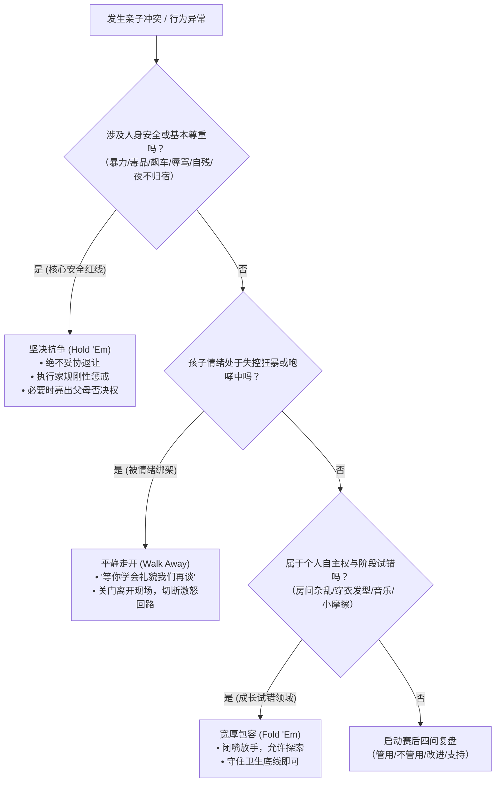

# 决策速查手册与判断法则 (Cheatsheet)

本手册专供高压力、高冲突情境下一线快速查阅，提炼作者核心判断准则与行动决策树。

---

## 一、核心决策规则 (Decision Rules: When-Do-Because)

1. **当孩子言语粗暴、摔门甚至声称“我恨你/别管我”时**
   - **执行**: 保持声调平稳，坚决留在现场门外，提供热饮并照常执行周末约定。
   - **原因**: 此时是大腿压杆压力测试；退缩会证实其“大人不可靠”的绝望预言，反击则将其推入敌方阵营。
2. **当孩子出现撒谎、夜不归宿、偷开车辆等背叛信任行为时**
   - **执行**: 启动当晚冷静期，次日依据成文家规暂停对应特权，以“我昨晚吓坏了”展示脆弱，要求通过增加报备重新赚回信用。
   - **原因**: 即兴咆哮只会引发自卫谎言；剥夺特定特权并要求小额存入信用，才能内化契约责任。
3. **当孩子因学业失利、违规被学校处分时**
   - **执行**: 绝不当场责骂，更不替其向老师求情脱罪；践行“罗德尼不保释法则”，陪同其亲自前往办公室道歉受罚并复盘。
   - **原因**: 痛苦是成熟最好的肥料；剥夺其承担现实后果的机会，将亲手制造出终生巨婴。
4. **当孩子提出惊世骇俗、不切实际的梦想（如退学创业/当网红）时**
   - **执行**: 不泼冷水也不盲目赞同；协助其搭建为期3个月的最小可行性实验沙盒（采访3位从业者+影子实习）。
   - **原因**: 粗暴打击会诱发全能自恋的逆反反弹；让真实行业数据亲自教导其成长。
5. **当发现孩子有大麻、毒品、自残或色情短信苗头时**
   - **执行**: 坚决摒弃面子与侥幸，立即“过度反应”——收缴锐器/锁死药箱、启动非处方尿检、引入专业青少年心理干预。
   - **原因**: 父母潜意识普遍“反应不足”；此类危机不具备自愈性，早期铁腕是切断坠崖滑坡的唯一生机。

---

## 二、冲突情境决策树 (Conflict Decision Tree)

---

## 三、青春期各阶段核心问号与战术速查

| 年龄阶段 | 核心灵魂发问 | 生活焦点 | 成人关键角色 | 必杀技行动 |
| :--- | :--- | :--- | :--- | :--- |
| **11～12岁** | “谁喜欢我？” | 寻求同伴接纳 | **提供安全保障** | 抢抓最后黏人期、探险心愿单、性教育正向启动 |
| **12～14岁** | “我是谁？” | 探索自我认同 | **肯定显露长处** | 车内闲聊圣地、每日具体赞美、共同协商成文家规 |
| **14～15岁** | “我究竟属于哪里？” | 同伴部落与朋友 | **了解孩子圈子** | 开放家庭客厅、哲学式发问、审慎行使父母否决权 |
| **15～16岁** | “为什么我不能？” | 追寻自由与独立 | **树立核心价值** | 建设性冒险置换、脱敏谈恋爱与性、卡片主动温情 |
| **16～17岁** | “我如何变得重要？” | 展现卓尔不同 | **培养独特才能** | 才能学徒制、梦想沙盒测试、“这可不像你自己”干预 |
| **17～18岁** | “我将来做什么？” | 毕业与未来过渡 | **辅导现实选择** | 破除一生规划枷锁、聚焦蹒跚学步、罗德尼不保释法则 |

---

## 四、警戒指标、生理常数与默认阈值 (Thresholds & Defaults)

- **睡眠生理阈值**: 11~18岁青少年每晚必须保障 **9~11小时** 睡眠；褪黑素分泌周期生理性推迟 **2小时**（晚上11点前极难入睡属正常生物钟）。
- **屏幕物理宵禁**: 每晚 **9:00~10:00** 前所有设备统一送入公共充电站，卧室严禁过夜。
- **心理咨询尝试契约**: 约定 **5次** 为基础评估周期，赋予孩子 **1票否决权**。
- **7大危机预警并发线**: 睡眠突变、饮食突变、注意力涣散、成绩暴跌、极度暴躁、作息路线突变、社交圈骤变中，一旦出现 **3项并发**，必须立即启动专业干预。
- **肯尼·罗杰斯战场配比**: 80%的日常琐事选择包容放手，20%的安全尊重底线誓死抗争。

---

## 五、情境嗅觉与危险直觉 (Tells & Smells)

- **危险信号**: 突然决定永远关起房门只在卧室吃饭、大热天反常穿着长袖遮挡手腕、频繁锁门且习惯性清空上网历史。
- **谎言信号**: 解释去向时过度详尽、声音细微发颤、眼神无法直视。
- **成瘾信号**: 眼神涣散、食欲无端大起大落、家里散落无处方包装锡纸、父母钱包频繁失窃零钱。
- **网络网暴信号**: 收到手机推送后脸色惨白、突然注销经营多年的社交账号、抗拒去学校。
